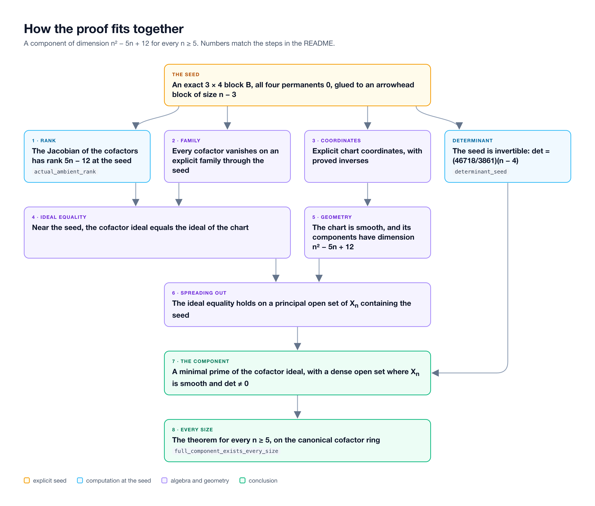

# A component of the permanental cofactor scheme for every size

For every `n ≥ 5`, take an `n × n` matrix of independent complex entries and set every
`(n − 1) × (n − 1)` permanent to zero. This folder proves, in Lean 4 with Mathlib, that the
resulting affine scheme has an irreducible component of dimension

```
n² − 5n + 12
```

with a dense open subset on which the scheme is smooth and the matrix is invertible.

The construction builds on a known `3 × 4` piece of the permanental geometry (see
[Prior work](#prior-work)). We found no statement of this all-size result in the literature we
checked, but we have not established that it is new.

## The statement

Let `X_n` be the affine scheme over `ℂ` cut out by the `n²` unsigned `(n − 1) × (n − 1)` permanents
of the generic `n × n` matrix. For every `n ≥ 5` there is a minimal prime `P` of its coordinate ring
such that

- the quotient by `P` has Krull dimension `n² − 5n + 12`, so `V(P)` is an irreducible component of
  `X_n` of that dimension;
- `V(P)` contains a nonempty open subset `U`, dense in `V(P)`, on which `X_n` itself is smooth over
  `ℂ` and the determinant of the matrix is nonzero.

The defining ideal is not assumed to be reduced or radical. The component is a minimal prime of the
actual cofactor ideal, and smoothness is smoothness of the actual scheme, not of its reduction.

In Lean this is `ComponentCanonicalProblem.full_component_exists_every_size` in
[`new/CanonicalProblem/EverySize.lean`](new/CanonicalProblem/EverySize.lean):

```lean
theorem full_component_exists_every_size (n : ℕ) (hn : 5 ≤ n) :
    ∃ k : ℕ, 3+k+1 = n ∧
      ∃ P : Ideal (CoordinateAlgebra k), IsMinimalPrime P ∧
        ringKrullDim (CoordinateAlgebra k ⧸ P) = ((n^2-5*n+12 : ℕ) : WithBot ℕ∞) ∧
        zeroLocus (P : Set (CoordinateAlgebra k)) ∈
          irreducibleComponents (PrimeSpectrum (CoordinateAlgebra k)) ∧
        ∃ f : CoordinateAlgebra k, ∃ U : Set (PrimeSpectrum (CoordinateAlgebra k)),
          U = zeroLocus P ∩ (basicOpen f : Set (PrimeSpectrum (CoordinateAlgebra k))) ∧
          U.Nonempty ∧ closure U = zeroLocus P ∧
          (∀ x ∈ U, x ∈ Algebra.smoothLocus ℂ (CoordinateAlgebra k) ∧
            canonicalDeterminant k ∉ x.asIdeal)
```

`CoordinateAlgebra k` is the polynomial ring in the entries of a `(3 + k + 1) × (3 + k + 1)` matrix,
divided by all of its unsigned `(3 + k) × (3 + k)` permanents. The theorem gives `k = n − 4` and
states the equality `3 + k + 1 = n` explicitly.

## The seed

The component passes through one explicit matrix for each `n`. Its first three rows are

```
U | v | 2v ... 2v
```

where `U | v` is the `3 × 4` matrix

```
    1     1        1      1
B = 1    7/9   −238/117   2
    1  −35/33    7/78    5/22
```

and `2v` is repeated `n − 4` times. All four `3 × 3` permanents of `B` are zero. The last `n − 3`
rows are `0 | W`, where `W` is the arrowhead matrix of size `n − 3`: its first row and first column
are `1` except for the corner entry `−(n − 4)`, its other diagonal entries are `1`, and its other
entries are `0`. The permanent of `W` is zero.

For `n = 5` the seed is

```
1     1        1      1     2
1    7/9   −238/117   2     4
1  −35/33    7/78    5/22  5/11
0     0        0     −1     1
0     0        0      1     1
```

Every `(n − 1) × (n − 1)` permanent of the seed vanishes, and its determinant is
`(46718/3861)(n − 4)`, which is nonzero.

## How the proof goes

1. **Rank at the seed.** The Jacobian of the `n²` cofactor equations at the seed has rank `5n − 12`
   (`actual_ambient_rank`), so its kernel, the tangent space of `X_n` at the seed, has dimension
   `n² − 5n + 12` (`actual_ambient_kernel_finrank`).
2. **A family inside `X_n`.** Every cofactor vanishes on an explicit family of matrices through the
   seed, built from the `3 × 4` block and the arrowhead block.
3. **Chart coordinates.** Explicit coordinate changes, with proved inverses, describe that family by
   six invertible gauge parameters, a quadratic chart for the upper block, one lower entry solved
   linearly from the lower permanent, and free proportionality parameters.
4. **Ideal equality near the seed.** Using the rank, the cofactor ideal of `X_n`, localized near the
   seed, equals the ideal of the chart. This is equality of the actual ideals, not of their zero
   sets or radicals.
5. **Geometry of the chart.** The chart is smooth and each of its components has dimension
   `n² − 5n + 12`.
6. **Spreading out.** A finite-generation argument extends the local equality to a principal open
   set of `X_n` containing the seed, so the chart's smoothness and dimension transfer to `X_n`.
7. **The component.** Localizing further at the determinant, which is nonzero at the seed, gives a
   minimal prime of the cofactor ideal whose zero set has a dense, smooth, invertible open subset.
8. **Every size.** The construction is uniform in `k = n − 4` and is transported to the canonical
   cofactor ring of the independent-entry matrix.



## What the Lean proof checks

There are 267 Lean files: 113 in `src/`, from an earlier stage of the project, and 154 in `new/`,
which hold the all-size argument and the final theorem. Files in `new/` import files from `src/`.

The proof uses no `sorry`, no `admit`, no new axioms and no `native_decide`. The final theorem
depends only on Lean's standard axioms `propext`, `Classical.choice` and `Quot.sound`. No published
irreducibility result for the `3 × 4` variety is assumed: the dimension of the chart is proved from
polynomial, integrality, localization and minimal-prime arguments.

A clean rebuild of all 267 files with Lean 4.35.0 completed on 23 October 2026 with every compiler
process exiting successfully.

Some data files in `src/` were transcribed from exact computations in a computational mathematics
program; their comments name the experiment. Lean checks every such certificate itself, so the
proof does not depend on that program.

## Building

Requires [elan](https://github.com/leanprover/elan) and Python 3. The toolchain and the Mathlib
revision are pinned in `lean-toolchain` and `lake-manifest.json`.

The project has no Lake library targets. Instead, `replay-complete.py` copies every source file into
a fresh directory and compiles the files one by one in dependency order, without using any earlier
project build output. Python only launches the Lean compiler; it decides nothing mathematical.

From this folder:

```
lake exe cache get
python3 replay-complete.py --jobs 3
```

or run `./bootstrap.sh`, which does both. `python3 replay-complete.py --plan` lists the files in
build order without compiling. `new/CanonicalProblem/EverySize.lean` ends with
`#print axioms full_component_exists_every_size`, so its log shows the axioms.

## Scope

This proves that one component of the stated dimension exists for every `n ≥ 5`. It does not
classify the components of `X_n`, determine the dimension of `X_n`, or show that
`n² − 5n + 12` is the largest dimension of a component. Different component dimensions occur
already for `4 × 4` matrices, so this is not the first example of a non-equidimensional permanental
scheme.

## Prior work

- G. A. Kirkup, *Minimal primes over permanental ideals*, Trans. Amer. Math. Soc. 360 (2008)
  3751 to 3770, [arXiv:math/0510025](https://arxiv.org/abs/math/0510025). Sections 7 to 9 contain
  the nondegenerate `3 × 4` component, coordinate normalizations and block-type prime constructions,
  and classify the minimal primes of the `3 × 3` permanents of a `4 × 4` matrix. These are the
  ancestry of the construction here; they do not give the all-size family or its dimension.
- A. Boralevi, E. Carlini, M. Michałek, E. Ventura, *On the codimension of permanental varieties*,
  Advances in Mathematics 461 (2025) 110079, [arXiv:2402.17839](https://arxiv.org/abs/2402.17839).
  Definition 3.13 and Proposition 3.14 record the nondegenerate `3 × 4` variety as irreducible, of
  codimension four (affine dimension eight) and degree 66. The paper works with reduced varieties,
  so its results do not speak to smoothness of the scheme `X_n` itself.
- Y. Xie, *Dimensions of permanental varieties in arbitrary size*,
  [arXiv:2609.27320](https://arxiv.org/abs/2609.27320) (September 2026), studies maximal permanents
  of `k × (k + 1)` matrices. It does not classify components, and its results neither give nor rule
  out the component here.
- We have not read J. Cotter, *Permanental Ideals*, thesis, Reed College (2009), and cannot rule
  out that it overlaps with this result. If you know of an earlier statement, please open
  an issue.
